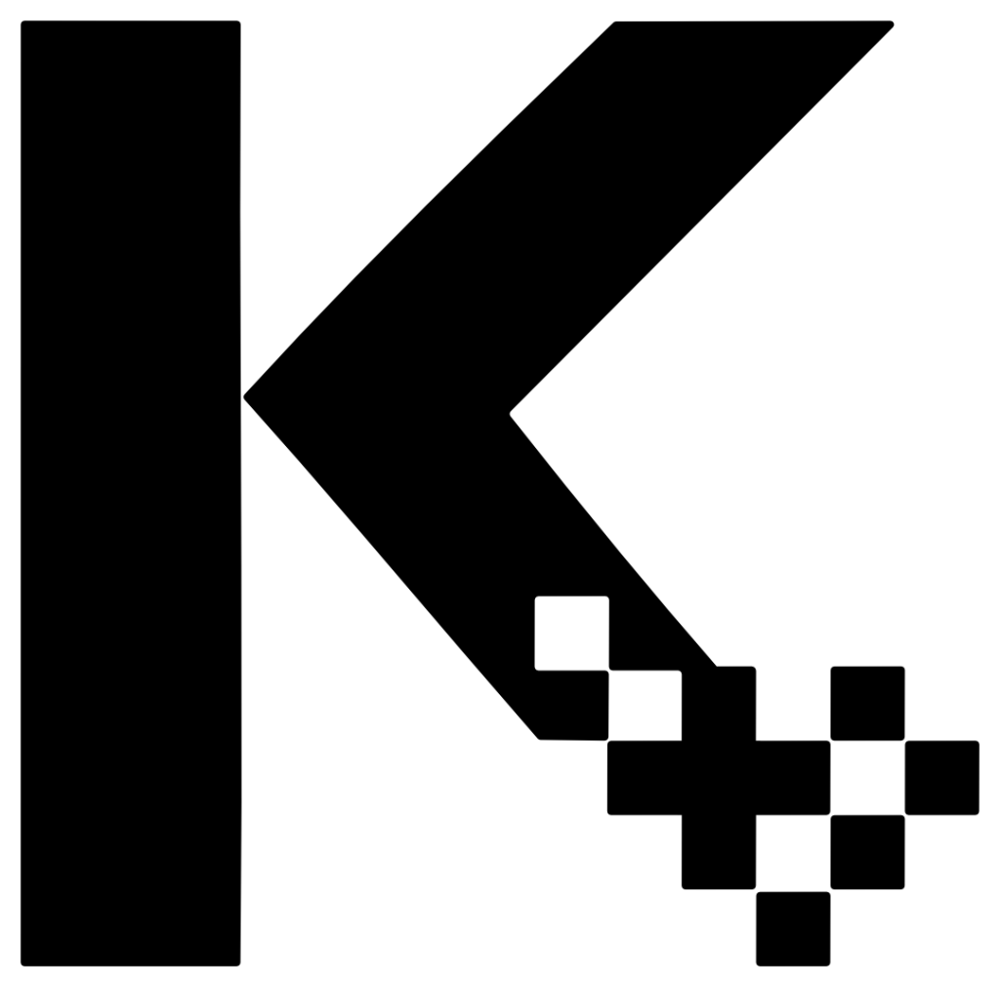

# KineCode — Dynamic Multi-Frame Animated QR Code

<div align="center">

<p align="center">
  <picture>
    <source media="(prefers-color-scheme: dark)" srcset="assets/logo-white.png">
    
  </picture>
</p>

[](https://www.npmjs.com/package/kinecode)


**Drop-in animated QR code generator & scanner that prevents photo sharing, video replays, and remote check-in spoofing.**  
Split and XOR-mask any destination URL or webhook across $N$ cyclic QR frames (`4`, `6`, `8`, `12`) that regenerate every cycle.

[Why KineCode?](#why-kinecode) • [Installation](#installation) • [Part 1: Generator Setup](#part-1-displaying-a-kinecode-generator) • [Part 2: Scanner Setup](#part-2-scanning--decoding-a-kinecode-scanner) • [Part 3: Server & Webhook Verification](#part-3-post-handshake--server-verification) • [Exported API Reference](#exported-functions--api-reference)

</div>

---

## Why KineCode?

Standard static QR codes used for **university attendance, event check-ins, classroom exams, and physical access** have two fatal flaws:
1. **The WhatsApp Photo Exploit:** One attendee takes a photo of the projected QR code and forwards it to a group chat; 50 absent peers scan the photo from home.
2. **The Link Copy-Paste Exploit:** A single static QR encodes a fixed URL in plain text that stays valid for the entire session.

**KineCode** solves both problems without requiring a complex backend:
- **Fragmented & XOR-Masked URL (`KC2` Protocol):** Your destination URL (`https://your-site.com/checkin`) is never encoded in a single QR frame. It is split across **$N$ cyclic frames** (`4`, `6`, `8`, or `12`) and XOR-masked with a rolling per-cycle nonce (`cycleNonce`). Taking a photo with a standard phone camera reveals nothing.
- **Continuous Per-Cycle Rotation (`rotateEveryCycle`):** Every pass generates brand-new QR frames with a new XOR nonce and fresh cryptographic signature. Frames from a previous cycle cannot be combined with frames from a new cycle.
- **Strict Burst & Freshness Enforcement:** The KineCode Scanner automatically detects how many frames the code requires (`Auto-Detect`), enforces a tight burst capture timer (preventing users from swiping through 4 photos in chat), and rejects recorded videos older than `maxAge` seconds (default `6s`).

```
┌─────────────────────────────────────────┐            ┌─────────────────────────────────────────┐
│       HOST WEBSITE / PROJECTOR          │            │      ATTENDEE PHONE (APP / WEB APP)     │
│      (<kine-code> / Generator)          │            │    (<kine-scanner> / FrameCollector)    │
│                                         │  Live Scan │                                         │
│  - Splits URL across N frames (4..12)   │  ~1.0-2.0s │  - Auto-detects N frames (Zero Config)  │
│  - XOR-masks bytes with rolling Nonce   ├───────────►│  - Enforces burst timer (anti-photo)    │
│  - Signs timestamp + URL (HMAC-SHA256)  │            │  - Checks max-age timestamp (anti-video)│
│  - Never repeats past QR frames         │            │  - Unlocks Signed URL or POSTs Webhook  │
└─────────────────────────────────────────┘            └─────────────────────────────────────────┘
```

---

## Installation

Install `kinecode` via your preferred package manager:

```bash
# npm
npm install kinecode

# pnpm
pnpm add kinecode

# yarn
yarn add kinecode

# bun
bun add kinecode
```

### Zero-Install CDN (Plain HTML)

Load KineCode directly from **jsDelivr** or **unpkg** without a build step:

```html
<script type="module" src="https://cdn.jsdelivr.net/npm/kinecode/dist/kinecode.js"></script>
```

---

## Part 1: Displaying a KineCode (Generator)

Both `<kine-code>` (HTML Web Component) and `new Generator(options)` (JavaScript class) share the **exact same `camelCase` attribute/option names** (**1:1 standard**).

### 1.1 Generator Options Reference (`<kine-code>` & `new Generator`)

| Option / Attribute (`camelCase`) | Type | Default | Description |
| :--- | :--- | :--- | :--- |
| `url` | `string` | `''` | Destination URL or Webhook endpoint split and XOR-masked across the $N$ cyclic frames. |
| `frames` | `number` | `8` | Number of cyclic frames (`4`, `6`, `8`, `12`). **4 frames** = ~1.0s scan at 4 FPS; **8 frames** = ~2.0s scan. |
| `fps` | `number` | `4` | Frame rotation speed in Hz (`2`, `4`, `6`, `8`). Total cycle duration is `frames / fps` seconds. |
| `maxAge` | `number` | `6` | Freshness window in seconds. Recorded videos forwarded on chat apps fail once `maxAge` elapses. |
| `actionMode` | `'redirect' \| 'webhook' \| 'both'` | `'redirect'` | What the scanner does after unlocking all $N$ frames (open Signed URL, `POST` JSON to webhook, or both). |
| `rotateEveryCycle` | `boolean` | `true` | Generates a new XOR `cycleNonce` and signature after each cycle pass so past photos are useless. |
| `sessionId` | `string \| number` | `'0x1A2B3C4D'` | 32-bit room, lecture, or event identifier (e.g. `'0xCAFE1234'` or `3405697588`). |
| `secretKey` | `string \| Uint8Array` | Random 32B | 64-character hex secret key (32 bytes) used to sign the payload via HMAC-SHA256. |
| `size` | `number` | `600` | Display width/height in pixels. |

#### Choosing `frames` vs `fps` (Scan Speed vs Security)

| `frames` | At `2 FPS` | At `4 FPS` (Recommended) | At `6 FPS` | At `8 FPS` | Best Use Case |
| :--- | :--- | :--- | :--- | :--- | :--- |
| **`4` Frames** | `~2.0s` | **`~1.0s`** | `~0.7s` | `~0.5s` | Fast lecture check-in, turnstiles, quick doors |
| **`6` Frames** | `~3.0s` | **`~1.5s`** | `~1.0s` | `~0.8s` | Balanced classroom & conference attendance |
| **`8` Frames** | `~4.0s` | **`~2.0s`** | `~1.3s` | `~1.0s` | High-security exams & longer URLs |
| **`12` Frames** | `~6.0s` | **`~3.0s`** | `~2.0s` | `~1.5s` | Maximum fragmentation & strict proximity |

---

### 1.2 Framework Integration Examples (Generator)

#### A) Plain HTML / Vanilla JS

```html
<!-- Option 1: Declarative Web Component -->
<script type="module" src="https://cdn.jsdelivr.net/npm/kinecode/dist/kinecode.js"></script>

<kine-code
  url="https://presenze.unimi.it/checkin?aula=302"
  frames="4"
  fps="4"
  maxAge="6"
  actionMode="redirect"
  rotateEveryCycle="true"
  sessionId="0xCAFE1234"
  secretKey="0102030405060708090a0b0c0d0e0f101112131415161718191a1b1c1d1e1f20"
  size="500">
</kine-code>
```

```html
<!-- Option 2: Programmatic Vanilla JS -->
<canvas id="qr-canvas"></canvas>

<script type="module">
  import { Generator } from 'https://cdn.jsdelivr.net/npm/kinecode/dist/kinecode.js';

  const generator = new Generator({
    canvas: document.getElementById('qr-canvas'),
    url: 'https://presenze.unimi.it/checkin?aula=302',
    frames: 4,
    fps: 4,
    maxAge: 6,
    actionMode: 'redirect',
    rotateEveryCycle: true,
    sessionId: '0xCAFE1234',
    secretKey: '0102030405060708090a0b0c0d0e0f101112131415161718191a1b1c1d1e1f20',
    size: 500
  });

  generator.start();
</script>
```

#### B) React / Next.js / Vite

```tsx
import { useEffect, useRef } from 'react';
import { Generator, type ActionMode } from 'kinecode';

interface KineCodeProps {
  url: string;
  frames?: number;
  fps?: number;
  maxAge?: number;
  actionMode?: ActionMode;
  sessionId?: string | number;
  secretKey: string;
  size?: number;
}

export function KineCodeQR({
  url,
  frames = 4,
  fps = 4,
  maxAge = 6,
  actionMode = 'redirect',
  sessionId = '0xCAFE1234',
  secretKey,
  size = 500
}: KineCodeProps) {
  const canvasRef = useRef<HTMLCanvasElement | null>(null);

  useEffect(() => {
    if (!canvasRef.current) return;

    const generator = new Generator({
      canvas: canvasRef.current,
      url,
      frames,
      fps,
      maxAge,
      actionMode,
      rotateEveryCycle: true,
      sessionId,
      secretKey,
      size
    });

    generator.start();
    return () => generator.stop();
  }, [url, frames, fps, maxAge, actionMode, sessionId, secretKey, size]);

  return <canvas ref={canvasRef} style={{ width: '100%', maxWidth: `${size}px`, borderRadius: '12px' }} />;
}
```

#### C) Vue 3 / Nuxt

```vue
<template>
  <canvas ref="canvasEl" style="width: 100%; max-width: 500px; border-radius: 12px" />
</template>

<script setup lang="ts">
import { ref, onMounted, onUnmounted } from 'vue';
import { Generator } from 'kinecode';

const canvasEl = ref<HTMLCanvasElement | null>(null);
let generator: Generator | null = null;

onMounted(() => {
  if (!canvasEl.value) return;
  generator = new Generator({
    canvas: canvasEl.value,
    url: 'https://presenze.unimi.it/checkin?aula=302',
    frames: 4,
    fps: 4,
    maxAge: 6,
    actionMode: 'redirect',
    sessionId: '0xCAFE1234',
    secretKey: '0102030405060708090a0b0c0d0e0f101112131415161718191a1b1c1d1e1f20',
    size: 500
  });
  generator.start();
});

onUnmounted(() => generator?.stop());
</script>
```

#### D) Angular (Standalone v17+)

```typescript
import { Component, CUSTOM_ELEMENTS_SCHEMA } from '@angular/core';
import 'kinecode'; // Registers <kine-code> and <kine-scanner>

@Component({
  selector: 'app-attendance-qr',
  standalone: true,
  schemas: [CUSTOM_ELEMENTS_SCHEMA],
  template: `
    <kine-code
      url="https://presenze.unimi.it/checkin?aula=302"
      frames="4"
      fps="4"
      maxAge="6"
      actionMode="redirect"
      rotateEveryCycle="true"
      sessionId="0xCAFE1234"
      secretKey="0102030405060708090a0b0c0d0e0f101112131415161718191a1b1c1d1e1f20"
      size="500">
    </kine-code>
  `
})
export class AttendanceQrComponent {}
```

---

## Part 2: Scanning & Decoding a KineCode (Scanner)

> **Which one do you need? (Pick ONLY ONE based on your platform)**
> - **Web (Drop-in HTML Widget):** Use **`<kine-scanner>`** if you want a ready-made camera widget with 1 HTML tag.
> - **Web (Custom React / Vue / JS UI):** Use **`new Scanner(options)`** if you want full control over your own `<video>` element and modal UI.
> - **Native Mobile App (React Native / Expo / iOS / Android):** Use **`new FrameCollector(options)`** if you already read QR strings with a native mobile camera (`expo-camera`, `VisionCamera`, etc.) and only need the KineCode multi-frame decoder.

### 2.1 Scanner Options Reference (Unified `camelCase`)

| Option / Attribute (`camelCase`) | Type | Default | Description |
| :--- | :--- | :--- | :--- |
| `secretKey` | `string \| Uint8Array` | `undefined` | Optional 32-byte hex key to verify the HMAC signature locally on the client. |
| `maxAge` | `number` | `6` | Maximum allowed token age in seconds before rejecting a recorded video. |
| `maxCaptureMs` | `number` | Auto (~3000ms) | Maximum burst time in ms from the first locked frame to the $N$-th frame. |
| `webhookUrl` | `string` | `undefined` | Optional override endpoint to `POST` verified scan results. |
| `autoRedirect` | `boolean` | `false` | Automatically redirects the browser to `signedUrl` when `actionMode` is `'redirect'` or `'both'`. |
| `autoStart` | `boolean` | `false` | (`<kine-scanner>` only) Automatically requests camera permission on mount. |

---

### 2.2 Web Option A: `<kine-scanner>` Web Component

```html
<script type="module" src="https://cdn.jsdelivr.net/npm/kinecode/dist/kinecode.js"></script>

<kine-scanner
  autoStart="true"
  autoRedirect="false"
  maxAge="6">
</kine-scanner>

<script>
  const scanner = document.querySelector('kine-scanner');

  // Fired whenever a new frame in the cycle is locked (e.g. 1/4, 2/4, 3/4)
  scanner.addEventListener('scan-progress', (e) => {
    console.log(`Capturing: ${e.detail.lockedFrames} / ${e.detail.totalFrames} frames`);
  });

  // Fired when all N frames are unlocked and verified
  scanner.addEventListener('valid-scan', (e) => {
    const result = e.detail;
    console.log('Unlocked Signed URL:', result.signedUrl);
    console.log('Session ID:', result.sessionId);
    // Redirect user or submit attendance to your backend:
    window.location.href = result.signedUrl;
  });

  // Fired if a scan fails (e.g. expired video recording or invalid signature)
  scanner.addEventListener('scan-error', (e) => {
    console.warn('Scan rejected:', e.detail.error);
  });
</script>
```

---

### 2.3 Option B: React / Vue / JS Web Camera (`new Scanner`)

```tsx
import { useEffect, useRef, useState } from 'react';
import { Scanner, type VerificationResult } from 'kinecode';

export function KineScannerView({ onVerified }: { onVerified: (res: VerificationResult) => void }) {
  const videoRef = useRef<HTMLVideoElement | null>(null);
  const overlayRef = useRef<HTMLCanvasElement | null>(null);
  const [progress, setProgress] = useState({ locked: 0, total: 0 });

  useEffect(() => {
    if (!videoRef.current || !overlayRef.current) return;

    const scanner = new Scanner({
      videoElement: videoRef.current,
      overlayCanvas: overlayRef.current,
      maxAge: 6,
      autoRedirect: false,
      onProgress: (locked, total) => setProgress({ locked, total }),
      onValidScan: (result) => {
        if (result.valid) onVerified(result);
      }
    });

    scanner.startCamera();
    return () => scanner.stop();
  }, [onVerified]);

  return (
    <div style={{ position: 'relative', maxWidth: '480px', width: '100%' }}>
      <video ref={videoRef} playsInline muted style={{ width: '100%', borderRadius: '12px' }} />
      <canvas ref={overlayRef} width={640} height={480} style={{ position: 'absolute', inset: 0, width: '100%' }} />
      <p>
        {progress.total > 0
          ? `Locked: ${progress.locked} / ${progress.total} frames`
          : 'Point camera at KineCode (Auto-Detect)...'}
      </p>
    </div>
  );
}
```

---

### 2.4 Option C: Custom / Native Mobile App Scanner (`FrameCollector`)

If you already have a mobile app (React Native `expo-camera`, `react-native-vision-camera`, Capacitor, or Web Worker) with a native QR barcode reader, use **`FrameCollector`**. Feed each raw QR string read by the hardware camera into `collector.pushFrame(qrString)`:

```typescript
import { FrameCollector } from 'kinecode';

// Instantiate once (auto-detects 4, 6, 8, or 12 frames automatically)
const collector = new FrameCollector({
  secretKey: '0102030405060708090a0b0c0d0e0f101112131415161718191a1b1c1d1e1f20', // Optional
  maxAge: 6 // Rejects recorded videos older than 6s
});

// Inside your camera's onBarcodeScanned callback:
function onQrCodeRead(rawQrString: string) {
  const step = collector.pushFrame(rawQrString);

  if (step.status === 'collecting') {
    console.log(`Progress: ${step.lockedFrames} / ${step.totalFrames} frames`);
  } else if (step.status === 'verified') {
    console.log('✅ Unlocked Signed URL:', step.result?.signedUrl);
    console.log('Captured in:', step.result?.captureDurationMs, 'ms');
  } else if (step.status === 'rejected') {
    console.warn('❌ Rejected:', step.result?.error);
  }
}
```

---

## Part 3: Post-Handshake & Server Verification

When all $N$ frames are captured, the scanner reconstructs the destination `url` and appends four cryptographic query parameters:

```text
https://presenze.unimi.it/checkin?aula=302&kc_session=0xCAFE1234&kc_ts=1729681204&kc_nonce=A7&kc_sig=a9f14bc32e7810
```

### 1-Line Backend Verification (`verifySignedUrl`)

To verify on your Node.js / Express / Next.js / Supabase backend that a request came from a live KineCode scan (and wasn't copy-pasted minutes later), call **`verifySignedUrl`**:

```typescript
import { verifySignedUrl } from 'kinecode';

const SECRET_KEY = process.env.KINECODE_SECRET_KEY!;

app.get('/checkin', (req, res) => {
  const fullUrl = `${req.protocol}://${req.get('host')}${req.originalUrl}`;

  // Verifies HMAC-SHA256 signature AND checks that kc_ts is within maxAge seconds
  const verification = verifySignedUrl(fullUrl, SECRET_KEY, { maxAge: 10 });

  if (!verification.valid) {
    return res.status(403).json({ error: verification.error });
  }

  // Confirmed live physical presence!
  return res.json({
    success: true,
    sessionId: verification.sessionId,
    ageSeconds: verification.timeDiffSeconds
  });
});
```

---

## Exported Functions & API Reference

All classes and low-level cryptographic/framing functions are exported directly from the root `kinecode` package:

| Export | Kind | Description |
| :--- | :--- | :--- |
| `Generator` | Class | Renders the animated multi-frame QR code on an `HTMLCanvasElement`. |
| `Scanner` | Class | Camera + AR HUD scanner that decodes frames via `jsQR` and verifies liveness. |
| `FrameCollector` | Class | Stateful headless collector (`pushFrame(qrText)`) for React Native / custom scanners. |
| `KineCodeElement` | Custom Element | `<kine-code>` Web Component class (auto-registered on import). |
| `KineScannerElement` | Custom Element | `<kine-scanner>` Web Component class (auto-registered on import). |
| `verifySignedUrl(url, key, opts)` | Function | 1-line server validator for reconstructed URLs (`kc_session`, `kc_ts`, `kc_sig`). |
| `decodeQrFrameString(qrText)` | Function | Decodes and validates a single `KC2:` or `KC:` frame string and checks its frame CRC-8. |
| `assembleDynamicEnvelope(map)` | Function | Unmasks XOR chunks and reconstructs a `DynamicEnvelope` from $N$ captured `FrameData` items. |
| `buildDynamicEnvelope(opts)` | Function | Packs `sessionId`, `timestampSec`, `maxAgeSec`, `signature7`, and `targetUrl` into a binary envelope. |
| `encodeEnvelopeToFrames(env, N, nonce)` | Function | Splits and XOR-masks a binary envelope across `N` cyclic `FrameData` objects. |
| `constructSignedUrl(url, id, ts, sig, nonce)` | Function | Appends `kc_session`, `kc_ts`, `kc_nonce`, and `kc_sig` query parameters to a URL. |
| `generateKeyPair()` | Function | Generates a new random 32-byte hex/byte secret keypair. |
| `computeTruncatedHmacSync(msg, key)` | Function | Synchronous 7-byte truncated HMAC-SHA256 signature calculator. |
| `fromHex(hex)` / `toHex(bytes)` | Function | Converts between hex strings and `Uint8Array`. |

---

## Monorepo Architecture & Repository Structure

The repository is organized as a clean workspace separating the core protocol/SDK, the Vite interactive web application, and the native Expo mobile scanner:

```text
kinecode/
├── packages/
│   └── kinecode/                  # Published npm package ("kinecode") — Protocol, Generator, Scanner & Web Components
│       ├── src/
│       │   ├── core/              # Framing (KC2 envelope, FrameCollector), CRC-8, HMAC-SHA256 / Ed25519
│       │   ├── generator/         # Generator class, <kine-code> Web Component & visual skins
│       │   ├── scanner/           # Scanner class, <kine-scanner> Web Component, CornerDetector & AntiStream
│       │   └── index.ts           # Public SDK entry point
│       └── test/                  # Vitest unit & end-to-end optical test suites
├── web/                           # Interactive Web Dashboard, QR Builder & Standalone Web Scanner (Vite)
│   ├── src/
│   │   ├── main.ts                # Dual Testbench, Live Code Inspector & QR Builder UI
│   │   └── scanner-page.ts        # Standalone mobile-web camera scanner
│   ├── index.html                 # Main web testbench & builder page
│   └── scanner.html               # Standalone web scanner page
├── mobile/                        # Native iOS / Android Hardware QR Scanner App (React Native / Expo)
│   ├── App.tsx                    # Uses expo-camera + FrameCollector from "kinecode"
│   └── metro.config.js            # Monorepo workspace bundler config
└── package.json                   # Root workspace scripts (dev, build, test, mobile)
```

---

## Automated Releases & CI/CD (GitHub Actions)

This repository includes two pre-configured GitHub Actions workflows in `.github/workflows/`:
1. **[`ci.yml`](.github/workflows/ci.yml):** Runs `npm test` and `npm run build` across `packages/kinecode` and `web` on every push and pull request.
2. **[`release.yml`](.github/workflows/release.yml):** Automatically runs on every push to `main`:
   - Increments the version in `packages/kinecode/package.json` (`minor` if the commit starts with `feat:`, otherwise `patch`).
   - Pushes the new Git tag (`v0.1.x`) and creates a **GitHub Release** with auto-generated release notes.
   - Publishes `packages/kinecode` to **npm** automatically if `NPM_TOKEN` is set in your GitHub repository secrets (*Settings → Secrets and variables → Actions → New repository secret → `NPM_TOKEN`*).

---

## License

Distributed under the **MIT License**. See [LICENSE](LICENSE) for details.
